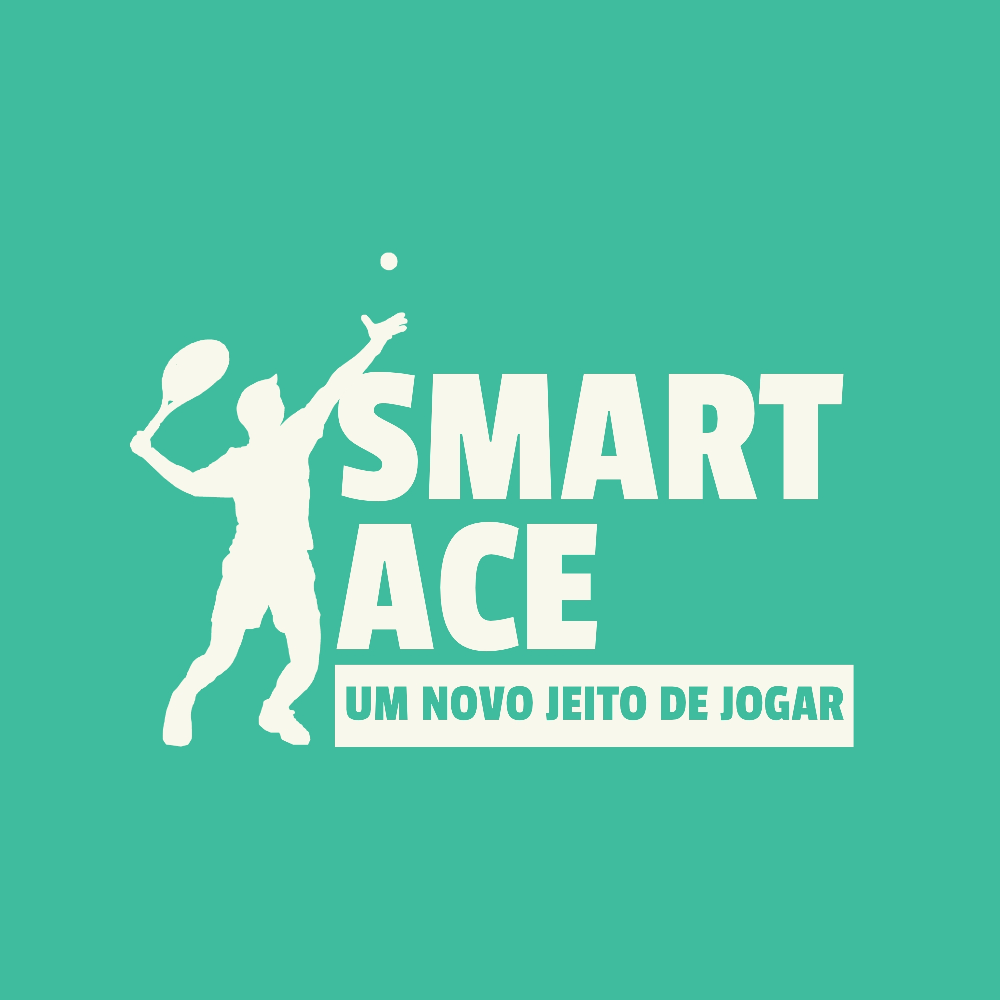

# FECAP - Fundação de Comércio Álvares Penteado

<p align="center">
<a href= "https://www.fecap.br/"></a>
</p>

# SmartAce

## Enrolados

## Integrantes: <a href="https://github.com/guibarioni"> Guilherme Barioni</a>, <a href=https://github.com/IuryXa>Iury Xavier</a>, <a href="https://github.com/lilianconde">Lilian Conde</a>, <a href="https://github.com/marcusduquee">Marcus Duque</a>, <a href="https://github.com/MuraCap4">Murilo Vieira</a>

## Professores Orientadores: <a href="https://www.linkedin.com/in/trencher/">João Francisco Trencher Martins</a>, <a href="https://www.linkedin.com/in/professorrodnil/">Rodnil da Silva Moreira Lisboa</a>, <a href="https://www.linkedin.com/in/victorbarq/">Victor Bruno Alexander Rosetti de Quiroz</a>, <a href="https://www.linkedin.com/in/edsonbarbero/">Edson Ricardo Barbero</a>, <a href="https://www.linkedin.com/in/katia-bossi/">Katia Milani Lara Bossi</a>

## Descrição

<p align="center">

  Logo by <a href="https://github.com/2026-2-NCC6/Projeto4">Enrolados</a> <a rel="license" href="https://creativecommons.org/licenses/by-sa/3.0/">CC BY-SA 3.0</a>
</p>

O SmartAce propõe uma solução acessível para apoiar o treinamento de tênis por meio de um protótipo
de raquete com ESP32 e sensores de movimento conectado por Bluetooth a um aplicativo Android. O
projeto busca reduzir a dependência de equipamentos especializados e facilitar o acompanhamento da
prática por jogadores, estudantes e treinadores.

## 🛠 Estrutura de pastas

-Raiz<br>
|<br>
|-->documentos<br>
  &emsp;|-->Entrega 1<br>
  &emsp;|-->Entrega 2<br>
|-->imagens<br>
  &emsp;|logos
|-->src<br>
  &emsp;|-->Entrega 1<br>
    &emsp;|-->Backend<br>
    &emsp;|-->Frontend<br>
  &emsp;|-->Entrega 2<br>
    &emsp;|-->Backend<br>
    &emsp;|-->Frontend<br>
|readme.md<br>

## 🛠 Instalação

<b>Android:</b>

Faça o Download do SmartAce.apk no seu celular.
Execute o APK e siga as instruções de seu telefone.

<b>Windows/Linux:</b>

# Modelo de visão computacional:
Rode os comandos a baixo na pasta /src/Entrega 2/Frontend/Detecção e visão computacional/:
```sh
pip install -r requirements.txt
streamlit run smarttennis_streamlit.py
```
# Dashboard:

Rode os comandos a baixo na pasta /src/Entrega 2/Frontend/Dashboard/:
```sh
pip install -r requirements.txt
streamlit run app.py
```

## 💻 Configuração para Desenvolvimento

Para abrir este projeto você necessita das seguintes ferramentas:

-<a href="https://nodejs.org">NODE.JS</a>
-<a href="https://dev.mysql.com/downloads/installer/">MySQL</a>
-<a href="https://www.arduino.cc/en/software/">Arduino IDE</a>
-<a href="https://www.python.org/downloads/">Python 3.15></a>
-<a href="https://git-scm.com/">Git</a>

Clone o projeto:
```sh
git clone https://github.com/2026-2-NCC6/Projeto4
cd Projeto4
```

# Ambiente APK

Abra o projeto na pasta "/src/Entrega 2/Frontend/SmartTennisApp/" no Android Studio

# Modelo de visão computacional:
Rode os comandos a baixo:
```sh
cd ./src/Entrega 2/Frontend/Detecção e visão computacional/
pip install -r requirements.txt
streamlit run smarttennis_streamlit.py
```
# Dashboard:

Rode os comandos a baixo:
```sh
cd ./src/Entrega 2/Frontend/Dashboard/
pip install -r requirements.txt
streamlit run app.py
```

# ESP32 + MPU-6050
Abra o detector_golpes.ino na pasta ./src/Entrega 2/Frontend/IoT/ no Arduino IDE
Instale as bibliotecas do ESP32
Conecte o seu ESP32 com o MPU-6050, com essas conexões:

| **ESP32** | **MPU-6050** |
| :--- | :--- |
| 5V | VCC |
| GND | GND |
| GPIO21 | SDA |
| GPIO22 | SCL |

# Banco de dados
Exporte o banco de dados no mysql com o comando abaixo:

# Backend
Rode os comandos a baixo:
```sh
cd ./src/Entrega 2/Backend
npm install
node server.js
```

## 📋 Licença/License
<a href="https://github.com/2026-2-NCC6/Projeto4">SmartAce</a> © 2026 by <a href="https://github.com/2026-2-NCC6">FECAP, Guilherme Barioni, Iury Xavier, Lilian Conde, Marcus Duque e Murilo Vieira</a> is licensed under <a href="https://creativecommons.org/licenses/by/4.0/">CC BY 4.0</a>

## 🎓 Referências

Aqui estão as referências usadas no projeto.

1. BOWERS, CHRIS. ITF GLOBAL TENNIS REPORT: PARTICIPATION HITS 106 MILLION IN FIVE YEARS. DISPONÍVEL EM: <https://www.itftennis.com/en/news-and-media/articles/itf-global-tennis-report-participation-hits-106-million-in-five-years/>. ACESSO EM: 04 NOV.. 2026.
2. ITF - ITF GLOBAL TENNIS REPORT 2021. DISPONÍVEL EM: <http://itf.uberflip.com/i/1401406-itf-global-tennis-report-2021>. ACESSO EM: 04 NOV.. 2026
